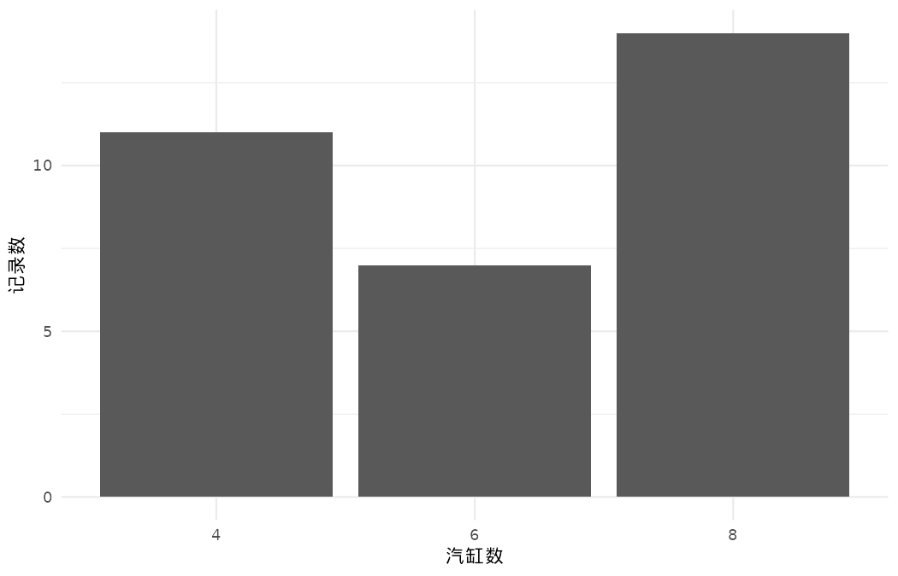
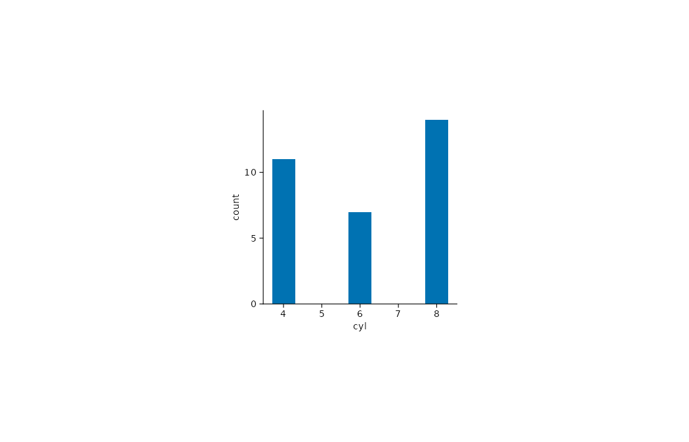

按汽缸数统计 mtcars 历史真实观测数据中的记录频数。频数由示例数据脚本使用 base R `aggregate()` 汇总；历史示例数据，仅用于绘图教学，不据此作当前总体推断。

## 数据与变量

CSV：[`mtcars.csv`](data/mtcars.csv)。`cyl` 是汽缸数，`count` 是按汽缸数分组的记录频数。

| cyl | count |
|---:|---:|
| 4 | 11 |
| 6 | 7 |
| 8 | 14 |

::: {.panel-tabset}

## ggplot2

{.plot-image}



## tidyplots

{.plot-image}



:::
