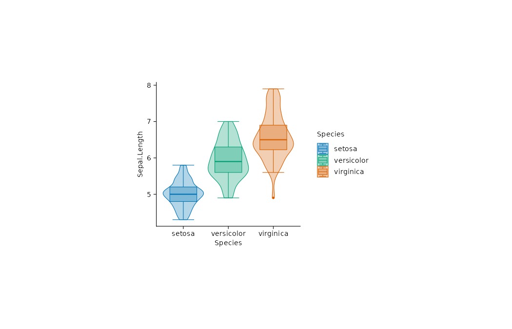

比较 iris 历史真实观测数据中不同物种的萼片长度分布。历史示例数据，仅用于绘图教学，不据此作当前总体推断。

## 数据与变量

CSV：[`iris.csv`](data/iris.csv)。`Species` 表示物种类别，`Sepal.Length` 表示萼片长度。

| Species | Sepal.Length |
|---|---:|
| setosa | 5.1 |
| setosa | 4.9 |
| setosa | 4.7 |
| setosa | 4.6 |
| setosa | 5.0 |

::: {.panel-tabset}

## ggplot2

{.plot-image}



## tidyplots

{.plot-image}



:::
