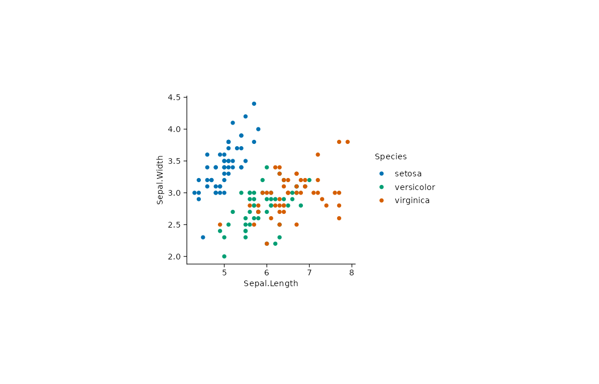

通过萼片长度与宽度观察 iris 历史真实观测数据中的记录，并用物种区分颜色。历史示例数据，仅用于绘图教学，不据此作当前总体推断。

## 数据与变量

CSV：[`iris.csv`](../data/iris.csv)。`Sepal.Length`、`Sepal.Width` 分别为萼片长度、宽度，`Species` 为鸢尾花物种类别。

| Sepal.Length | Sepal.Width | Species |
|---:|---:|---|
| 5.1 | 3.5 | setosa |
| 4.9 | 3.0 | setosa |
| 4.7 | 3.2 | setosa |
| 4.6 | 3.1 | setosa |
| 5.0 | 3.6 | setosa |

::: {.panel-tabset}

## ggplot2

{.plot-image}



## tidyplots

{.plot-image}



:::
