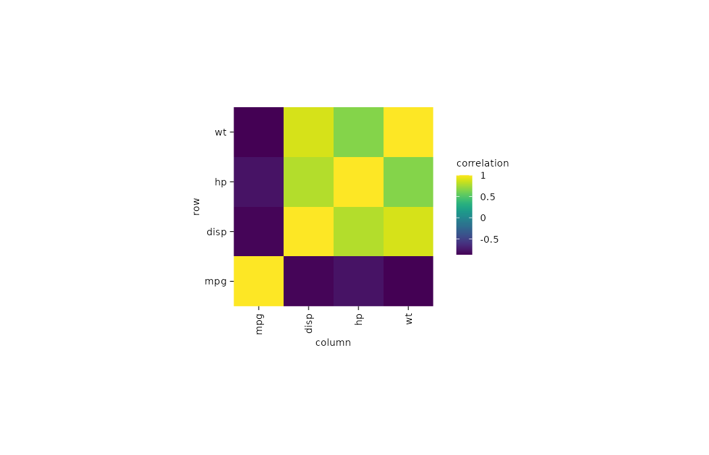

以颜色展示 mtcars 历史真实观测数据中 mpg、disp、hp、wt 四项变量的两两相关。相关系数由 base R `cor()` 计算，再转换成长表 `column`、`row`、`correlation`；历史示例数据，仅用于绘图教学，不据此作当前总体推断。

## 数据与变量

CSV：[`mtcars.csv`](data/mtcars.csv)。`mpg` 为燃油经济性，`disp` 为排量，`hp` 为马力，`wt` 为车重（千磅）。

| mpg | disp | hp | wt |
|---:|---:|---:|---:|
| 21.0 | 160.0 | 110 | 2.620 |
| 21.0 | 160.0 | 110 | 2.875 |
| 22.8 | 108.0 | 93 | 2.320 |
| 21.4 | 258.0 | 110 | 3.215 |
| 18.7 | 360.0 | 175 | 3.440 |

::: {.panel-tabset}

## ggplot2

{.plot-image}



## tidyplots

{.plot-image}



:::
