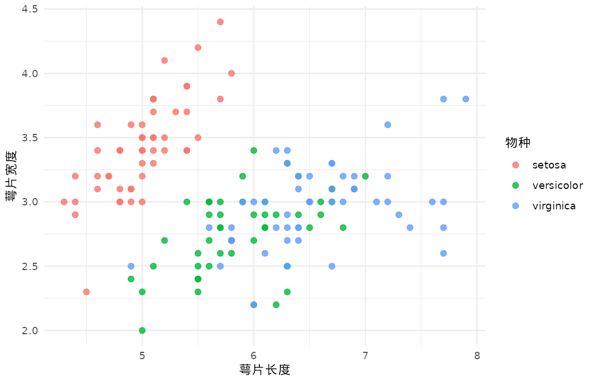
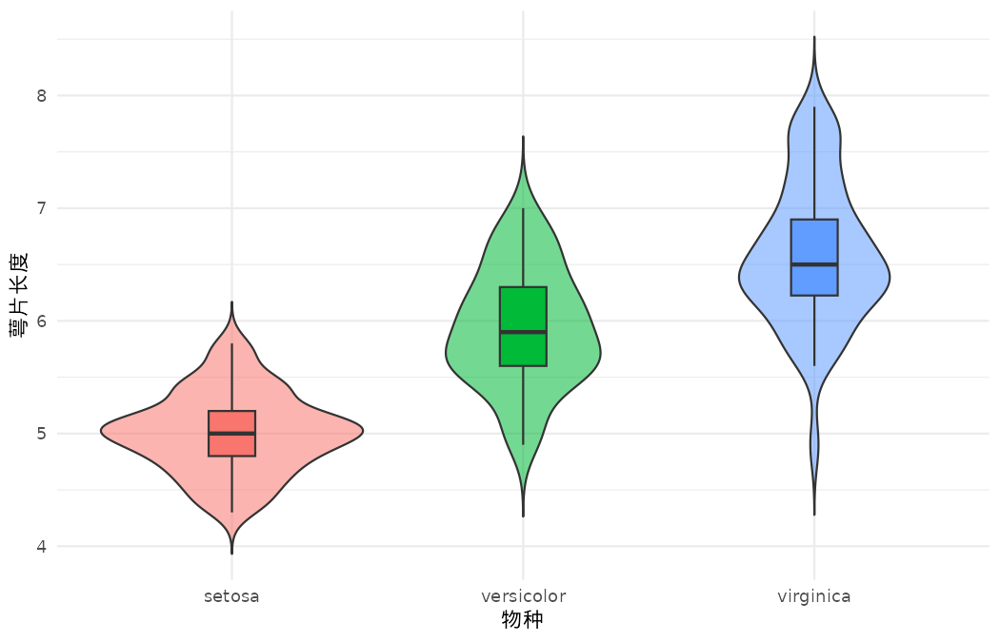
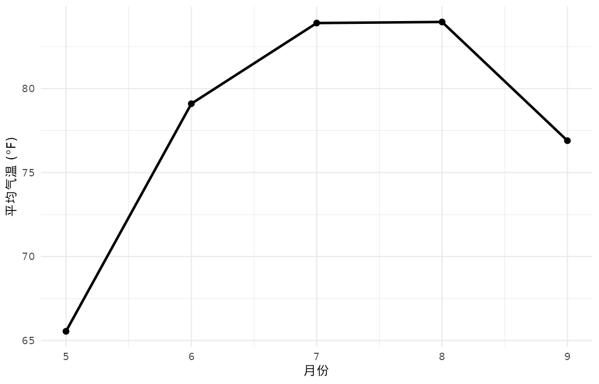
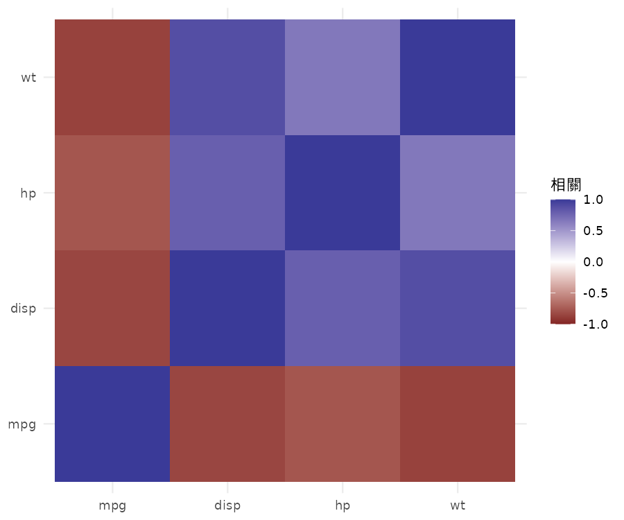

::: {.hero}
# 用图形看数据

一组轻巧、可复现的 R 可视化示例。浏览图形类型，比较 **ggplot2** 与 **tidyplots** 的表达方式；图像与代码均为示例素材，页面不会执行代码。
:::

::: {.card-grid}
::: {.plot-card}
### [散点图](gallery/scatter.qmd)

观察鸢尾花萼片长宽与品种。

{.plot-image}
:::

::: {.plot-card}
### [分布图](distribution.qmd)

比较不同品种的萼片长度。

{.plot-image}
:::

::: {.plot-card}
### [条形图](bar.qmd)

查看汽车数据中的汽缸数量频数。

{.plot-image}
:::

::: {.plot-card}
### [折线图](line.qmd)

查看 5—9 月平均气温变化。

{.plot-image}
:::

::: {.plot-card}
### [热图](heatmap.qmd)

探索汽车变量间的相关性。

{.plot-image}
:::
:::

::: {.data-note}
这里使用的 iris、mtcars 与 airquality 是历史真实观测数据。历史示例数据，仅用于绘图教学，不据此作当前总体推断。
:::
