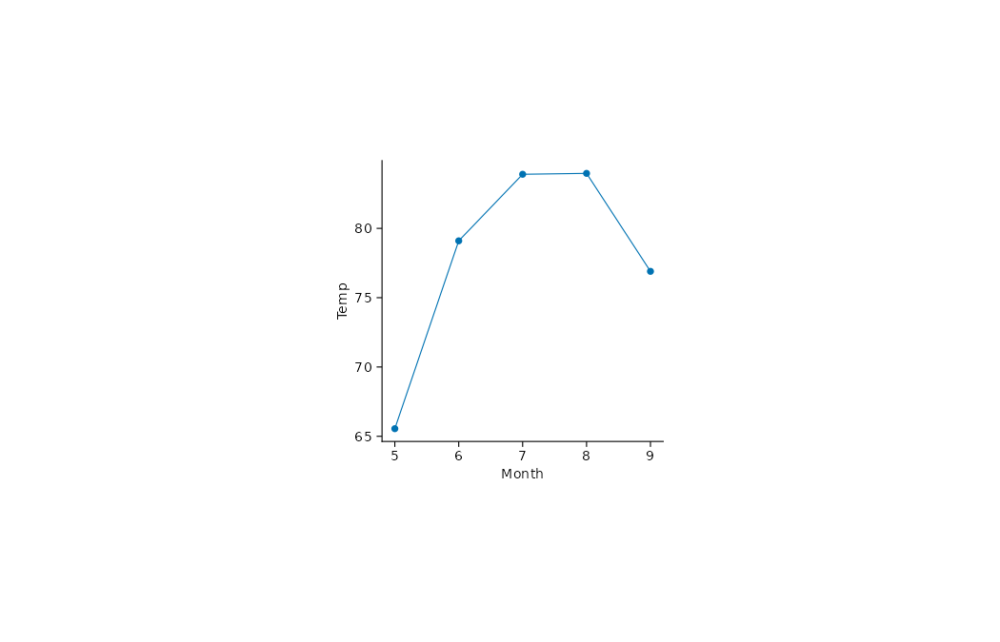

展示 airquality 历史真实观测数据中 5—9 月的月平均气温。历史示例数据，仅用于绘图教学，不据此作当前总体推断。

## 数据与变量

CSV：[`airquality.csv`](data/airquality.csv)。`Month` 为月份，`Temp` 为华氏温度；示例按月计算平均值，所用 5—9 月的温度记录无缺失。

| Month | 平均 Temp（°F） |
|---:|---:|
| 5 | 65.55 |
| 6 | 79.10 |
| 7 | 83.90 |
| 8 | 83.97 |
| 9 | 76.90 |

::: {.panel-tabset}

## ggplot2

{.plot-image}



## tidyplots

{.plot-image}



:::
